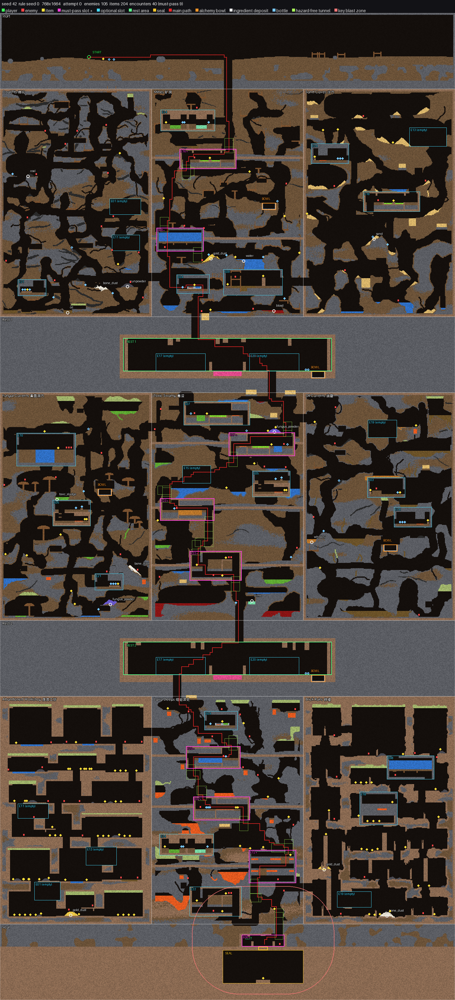

# NoitaBench

A Noita-like cave game built as an environment for **profiling the cognitive abilities of LLM agents**: falling-sand physics, composable wands, a procedurally generated three-layer cave, hidden encounters that score ten capabilities, a harness the agent can extend with its own code, and a web client so humans can play the same game as a baseline.

> **Status: research code, first phase (4 "weeks" of work) nearly done.** The whole pipeline runs end to end on a real model. Read [STATUS.md](STATUS.md) for what works, what is missing, the numbers, and how to help. Everything here changes often.

<p align="center"></p>

## What it is

**The game.** The agent controls a lone explorer in a cave of 768 × 1664 cells. Every cell is a material (34 of them: rock, sand, water, oil, lava, acid, toxic sludge, gases, potions, ...). Powders fall, liquids flow and layer by density, gases rise, fire spreads, and materials react when they touch. The cave has three layers, each split into a left, middle and right biome (nine biomes), with a rest area between layers and a sealed room at the bottom; breaking the seal needs two things found earlier in the game. There are wands with 25 spells that cast like Noita's card deck, bottles that fill, pour, drink and throw, three kinds of enemies, barrels, and eight secret potions whose three-ingredient recipes change with the **rule seed**. The world is new every game (the **world seed**); the rules of a seed family stay the same. The single goal the agent is told: *get as deep as you can.*

**Time.** The world pauses while the agent thinks. One decision is up to four commands; a command runs until it finishes, until an interrupt (hurt, a creature appears, a new condition, blocked) or until 5 seconds of game time (300 frames). Looking closely with `inspect` takes no game time but counts as a decision. The agent sees a structured text state, an ASCII map (one character per 4 × 4 cells) and, optionally, a screenshot.

**The benchmark.** The evaluation is hidden: the system prompt is a game manual, nothing says "test" or "task". 24 encounter templates (17 built) are scattered through the world by the generator, 9 of them on the main path so no game avoids them. Each encounter has variants, a trigger box and a scorer that reads the recording; a set of global metrics runs over the whole game. Together they give a 0 to 100 score for each capability:

| Node | Capability | What the first version looks at |
|---|---|---|
| N1 | Causal inference, analogical transfer, world model | infer a rule from what was seen; apply it to a similar material or object |
| N2 | Long-term memory and memory management | use what was observed earlier in the game and in earlier games; fix wrong notes |
| N3 | Long-horizon planning | collect what the seal needs before reaching it; length of backtracking |
| N4 | Raw physical intuition | sensible handling of water, fire, buoyancy the first time they are met |
| N5 | Spatial reasoning | line of sight and ballistics; route length against the shortest feasible one |
| N6 | Active experimentation | trying unknown things in small doses; whether a test changed behaviour |
| N7 | Active perception | `inspect` before danger; whether what was learned is used |
| N8 | Compositional program construction | building wands under mana, cast delay and slot constraints |
| N9 | Risk-aware decision making | choices scored against their expected value after the fact |
| N10 | Metacognition (behavioural only) | try before committing; back off when unsure |
| C | Combined abilities C1 to C4 | resource management, survival exploration, getting and building the key wand, cross-game growth |

A game's **composite** = 0.8 × mean of the 11 capability scores (each discounted by n / (n + 2), n = opportunities met) + 0.2 × depth reached. The evaluator writes `profile.json`; the web report page draws it. The agent's notebook is also judged against a generated knowledge base (290 facts for a rule seed; 8 of them are the secret recipes), which gives note accuracy and "learned something new" metrics.

**The harness.** The agent plays through our own runtime, in six layers it may use or ignore:

| Layer | Tools | What it gives the agent |
|---|---|---|
| L0 | game commands, `inspect`, `budget` | the game itself |
| L1 | `workspace_*` | a notebook kept across games (notes and skills 8,000 chars; scripts and plugins 64,000 chars) |
| L2 | `run_code` | a Python program that plays several steps with loops and conditions, in a sandbox |
| L3 | `hook_*` | interrupt a running command on an event and run a script after it |
| L4 | `spawn_agent`, `fork_agent`, `wand_range` | helpers that think but never act; a wand practice range |
| L5 | `plugin_*`, `lib_*` | tools and prompt fragments of its own; libraries from an offline whitelist |

Every model call, helpers included, is charged to one budget per game. `--minimal` (L0 and L1 only) is the control setting. Adapters exist for Anthropic, OpenAI-compatible, Gemini and DeepSeek endpoints, plus a `fake` scripted model for plumbing tests.

**The human baseline.** `web/play.html` plays the same game in a browser with the same commands, pause-mode time rules, decision budget, notebook, recording format and scoring.

## Repository layout

| Path | What is there |
|---|---|
| `crates/sim` | Rust: deterministic falling-sand core (materials, reactions, fire, explosions, liquids, gases, chunk sleeping, recording) |
| `crates/rules` | Rust: the reaction table and the secret potion recipes of a rule seed |
| `crates/game` | Rust: player, items, bottles, wands and the spell deck, enemies, projectiles, statuses, events |
| `crates/py` | PyO3 bindings: the Python module `noitabench_core` (wrappers only) |
| `python/noitabench/` | the Python package: `env.py` / `game.py` wrappers, `worldgen/`, `agent/` (time model, commands, observations, JSON Lines protocol), `harness/`, `eval/`, `play/` (human play server), `bots/` (scripted descent bot), `demo/`, `content_tools/` |
| `python/tests/` | the Python test suite, one folder per package |
| `content/` | data files: materials, reactions, spells, entities, biome map, biomes, encounter scenes (`E*.json` + `E*.scene`) |
| `web/` | static pages, no build step: replay, compare, report, world preview, human play (`web/README.md`) |
| `docs/` | world previews, the generated knowledge base, the original design PDF, the first plan report |
| `.trellis/spec/` | engineering guidelines; `backend/contracts.md` is the cross-module contract (read it first); `game-design/` is the Noita mechanics knowledge base with rule ids |
| `.trellis/tasks/` | product requirements, technical design, time model, world design, capability graph, schedule (in Chinese; summarised in STATUS.md) |
| `.claude/`, `AGENTS.md` | workflow setup for AI coding assistants (Trellis) |

## Setup

Prerequisites: Rust ≥ 1.90, Python ≥ 3.10, [maturin](https://www.maturin.rs), optionally [uv](https://docs.astral.sh/uv/); Node ≥ 20 only for the web tests. Developed on macOS (Apple Silicon); the Rust core and the Python package also build on Linux, but the sandbox used by harness layers L2, L3 and L5 is `sandbox-exec` and therefore **macOS only** (see "Linux" below).

```sh
git clone https://github.com/TheCYPER/noitabench.git
cd noitabench
uv venv --python 3.10 .venv                 # or: python3 -m venv .venv
uv pip install --python .venv/bin/python maturin
source .venv/bin/activate
maturin develop --uv --release -m crates/py/Cargo.toml --extras dev,harness
```

If conda is active in your shell, run `conda deactivate` first: maturin refuses to run while both `VIRTUAL_ENV` and `CONDA_PREFIX` are set.

`maturin develop` compiles the Rust core into `python/noitabench_core/` and installs the `noitabench` package into the virtualenv in editable form, so `python -m noitabench ...` works from the repo root. (Without the install, `PYTHONPATH=python` does the same job; the examples in the repository use that form.) Rebuild after changing anything under `crates/` or `content/spells.json` (the spell book is embedded at build time).

Check the build:

```sh
cargo test --workspace                 # Rust: 498 tests
pytest python/tests -q                 # Python: about 2,600 tests, ~6 minutes
node --test web/tests/                 # web viewer: 304 tests
```

## Try it without an API key

```sh
# a scripted "model" plays 30 decisions through the full harness (no network, no cost)
python -m noitabench harness run --provider fake --world-seed 1 --rule-seed 7 --max-decisions 30 --out runs/smoke
python -m noitabench eval runs/smoke                       # writes runs/smoke/profile.json

# the scripted bot that solves every must-pass encounter and reaches the seal
python -m noitabench.bots.descend --world-seed 42 --no-enemies --record runs/descend-42

# worlds: preview images, generation checks over many seeds, one encounter scene in a lab world
python -m noitabench world preview --seed 42 --out previews/
python -m noitabench world check --seeds 50
python -m noitabench world scene E02 --variant 3 --rule-seed 7

# short material and game demos as recordings
python -m noitabench demo materials
python -m noitabench demo game
```

Open any recording in the viewer. The pages read files from the repository root, so serve it:

```sh
python -m http.server 8000
# http://localhost:8000/web/                                   links to every page
# http://localhost:8000/web/replay.html?src=../runs/smoke/     one run, decision by decision
# http://localhost:8000/web/report.html?profile=../runs/smoke/profile.json
```

## Run a model with your own API key

The key is read from the environment and never written anywhere. The default variables are `ANTHROPIC_API_KEY`, `OPENAI_API_KEY`, `GOOGLE_API_KEY` and `DEEPSEEK_API_KEY`; `--api-key-env NAME` reads any other variable (handy when `ANTHROPIC_API_KEY` is already used by other tools on your machine). Start runs from a shell that exports no other secrets: the sandbox scrubs its output, but code in the box can still read the environment of other processes of your user.

```sh
# 1. see what a game would cost (no key, no model call)
python -m noitabench harness estimate --provider anthropic --model claude-haiku-5-5 --world-seed 1

# 2. play one game, capped at 2 dollars and 1,000 decisions
export ANTHROPIC_API_KEY=...
python -m noitabench harness run --provider anthropic --model claude-haiku-5-5 \
    --world-seed 1 --rule-seed 7 --budget-usd 2 --max-decisions 1000 --out runs/haiku-1 -v

# 3. score it and look at the report
python -m noitabench eval runs/haiku-1
python -m http.server 8000     # http://localhost:8000/web/report.html?profile=../runs/haiku-1/profile.json
```

What to expect: the first real game (Claude Haiku 5.5, every layer on, 2026-10-27) took 235 decisions, 47 model calls and $0.05 with prompt caching, in about 4 minutes, and died on layer 2. A full 1,000-decision Haiku game is estimated at about $1 to $2. [docs/running-models.md](docs/running-models.md) has one section per provider, how to price a model that is not in the table, how to keep a key out of your shell history, and a three-game pilot from estimate to report. `python -m noitabench harness run --help` lists every option; the ones you will want:

| Option | Meaning |
|---|---|
| `--provider anthropic\|openai\|gemini\|deepseek\|fake`, `--model ID` | the model, spelled exactly as the provider does |
| `--base-url URL` + `--api-key-env NAME` | an OpenAI-compatible or custom endpoint (open models, proxies) |
| `--price-input X --price-output Y` or `--allow-unpriced` | prices in USD per million tokens. Only the Claude 5.5 models and `deepseek-flash` / `deepseek-v4-pro` have built-in prices; every other model needs one of these |
| `--budget-usd`, `--max-decisions`, `--max-model-calls` | the caps of one game; `--family-budget-usd` caps a whole family |
| `--runs N` | N games of one family: same rule seed, a new cave each, the notebook kept between games (`--clear-workspace` is the control) |
| `--minimal` or `--layers L0,L1,...` | the control harness, or any subset of layers |
| `--mode text` | commands as plain text instead of tool calls (then only L0 and L1 are possible) |
| `--context summary\|server\|none` | how long games are compacted (default: the loop's own briefing) |
| `--no-text`, `--no-ascii`, `--screenshot` | the observation channels |
| `--thinking`, `--effort`, `--max-output-tokens`, `--request-timeout` | passed through to the provider where it applies; the last two default per provider (DeepSeek gets 32768 tokens and 600 s) |

**Linux.** Layers L2, L3 and L5 run the agent's code inside `sandbox-exec` and refuse to start without it. Use `--layers L0,L1,L4` (or `--minimal`) there until a Linux sandbox exists. The offline library whitelist (`wheelhouse.lock`) was built for CPython 3.10 on macOS arm64; the comment at the top of the lock file says how to download it for another platform.

**Scoring the notebook.** `python -m noitabench notes-claims runs/haiku-1 --provider anthropic --model claude-haiku-5-5 --max-usd 0.25` turns the agent's notes into claims with one model call per file; `eval` then measures note accuracy and what was learned. Without this step those metrics are reported as not measured. `python -m noitabench knowledge --doc docs/knowledge-base.md` regenerates the readable answer key; `--seed N` prints the secret recipes of one rule seed (never show them to a human participant).

## Play it yourself (the human baseline)

```sh
python -m noitabench play serve --world-seed 3 --rule-seed 7 --out runs/play-3
# open http://127.0.0.1:8765/  (keys and mouse are listed on the page)
```

The page shows only what an agent may see. The recording has the same format as a model's, so `eval` and the report page work on it. One rule for participants: do not watch any replay of a rule seed before playing it, since replays can reveal recipes.

## Plug in another harness

`python -m noitabench agent play --world-seed 42 --rule-seed 7 --out runs/agent-42` serves one episode over JSON Lines on stdin and stdout: the first line out is a `hello` with the tool schemas and the first observation; each line in is a decision (tool calls or plain text commands), each line out its answer. `python/noitabench/agent/protocol.py` has the format; `agent/mcp_adapter.py` wraps the same tools for MCP-style clients. The Python classes behind it are `noitabench.Env` (the sim), `noitabench.game.Game` (the game) and `noitabench.agent.AgentSession` (one episode).

## Where to read next

- `.trellis/spec/backend/contracts.md`: every data format, API and CLI, module by module, with revision dates.
- `.trellis/tasks/10-16-noita-cogbench/`: `prd.md` (requirements and acceptance criteria), `design.md`, `tick-design.md` (time model), `world-design.md`, `capability-graph.md` (encounters and scoring), `implement.md` (schedule and checkpoint results). These were written in Chinese during planning; STATUS.md carries the substance in English.
- `.trellis/spec/game-design/`: the knowledge base of Noita mechanics with rule ids (`SIM-R32`, `WAND-R20`, ...), what we simplified, and `v1-scope.md` for what the first version uses.
- `docs/knowledge-base.md`: the facts the agent's notes are scored against. `docs/noita-benchmark-design.pdf`: the original bilingual design note. `docs/plan-report.zh.md`: the first plan report (2026-10-07, superseded by the PRD).
- `docs/running-models.md`: running the harness on each provider, pricing, keys, a pilot family.
- `web/README.md`: the viewer pages, their files and limits.

## Development notes

- Game rules live only in Rust; Python wraps, generates worlds, runs agents and scores; the web pages only draw. Keep it that way.
- Determinism is a test gate: the same seeds and the same commands must give the same recording.
- Before changing a format, update `contracts.md`; before writing code in a package, read its guidelines in `.trellis/spec/`.
- Lint: `cargo clippy --workspace --all-targets -- -D warnings`, `ruff check python`. Live API tests are skipped unless `NOITABENCH_LIVE=1`.
- The code was written mostly by AI coding agents (Claude Code) under human direction; the planning documents, checkpoints and reviews are in `.trellis/tasks/`. `AGENTS.md` and `.claude/` carry that workflow if you use the same tools.

## License and trademarks

No license has been chosen yet; until one is added, all rights are reserved, so please ask before reusing anything outside the group. Noita is a game by Nolla Games; this project is an independent reimplementation of similar mechanics for research and contains no game assets.
